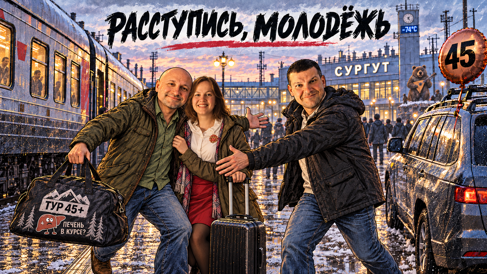

## Расступись, молодёжь. Мы в Сургут

Ещё летом мой корешок Ваня позвал меня в гости в Сургут на проводы 44 и встречу 45 его лет. И вот после трудного рабочего дня в четверг мы прыгнули с женой в паровоз и помчали на Севера!

Чтобы не попасть в финансовое рабство, купили билеты в плацкарт. И это нам аукнулось.

Ночью какой-то мужик минут 10-15 выкашливал свои лёгкие в соседнем отсеке. Перед этим смачно покурив на остановке в Тобольске. Короче, за ночь познакомились ближе, чем планировали.

> _МОРТ-7420611359042187: плацкарт - это когда на купе денег пожалел, зато присутствуешь при чужом вскрытии. Пациент пока сам проводит процедуру._

Каждый второй дичайше храпел. А моя боковушка вот ровно на 3-5 см не давала вытянуть ноги. Казалось бы, мелочь, но всю ночь эту мелочь хотелось кому-нибудь вернуть. И других билетов уже за 45 суток НЕ Б.Ы.Л.О.

> _МОРТ-7420611359042187: билет продан, пассажир размещён. Несовпадение габаритов человека с оплаченным пространством устраняется сгибанием человека. Претензии принимаются после кремации._

Короче, та ещё ночка. Но всё-таки щастливые утром в 6 мы выпрыгнули из вагона и прыгнули в тачку к Ване.

И сейчас ждём вечера пятницы, чтобы уйти в ~~бесконечный~~ недельный сиб-алкотрип-тур!

> _МОРТ-7420611359042187: 44 провожаем, 45 встречаем. Печень пока не в курсе, что её тоже пригласили на неделю._

Ёойху! Расступись, молодёжь.
