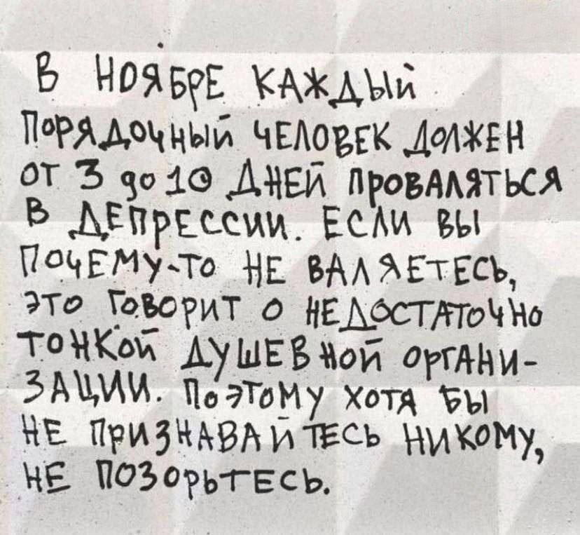

## November. A berry with mileage

_The end of the world went according to plan. Two survived. Asked how they were feeling, they asked for another photo._

Winter's here, and I'm already sick of the white stuff. November isn't even over. I look outside and try to remember how I signed up for several more months of this.

No money, AI is closing in, and I've got to hustle somehow. Where can I earn a bit extra? Preferably without taking another job. I've run out of places to put one in the day. Meanwhile, here I am figuring out AI and automating things. Makes sense. Who else is going to show it how to replace me?

> _MORT-7420611359042187: Position eliminated. The employee's participation in his own professional funeral has been recorded as a successful rollout. Shovel sold by subscription._

Then there's the dacha, the sauna, the building work, the whole lot. There's plenty I want to get done, and I don't feel like doing a damn thing. The foundation's there. The siding isn't. I've already finished it in my head, but somehow there's still nowhere to wash.

Depression, maybe? What fucking depression? I'm a millennial. Zoomers have a name for this. We came with «pull yourself together». Well, I did. Now I'm lying down, fully assembled. Worked a treat, thanks.

And then November rolls around and bang - I'm 45. There's a Russian saying that at 45 a woman is a berry again. I think I'm the one they left at the dacha and found after the frost. On paper I'm still part of the harvest. In person, there are questions.

> _MORT-7420611359042187: Upon inspection, the berry remains fit to service outstanding obligations. Fatigue does not qualify for a write-off. Deduct disposal costs from the remaining balance._

The meme says you're supposed to spend three to ten days lying around depressed in November. I just need to know where to file for those days. I keep feeling like I'm lying down off the clock and will have to make up the hours later.

Anyway, it got to me. Sometimes I need to dump this stream of consciousness here. Heh-heh.

