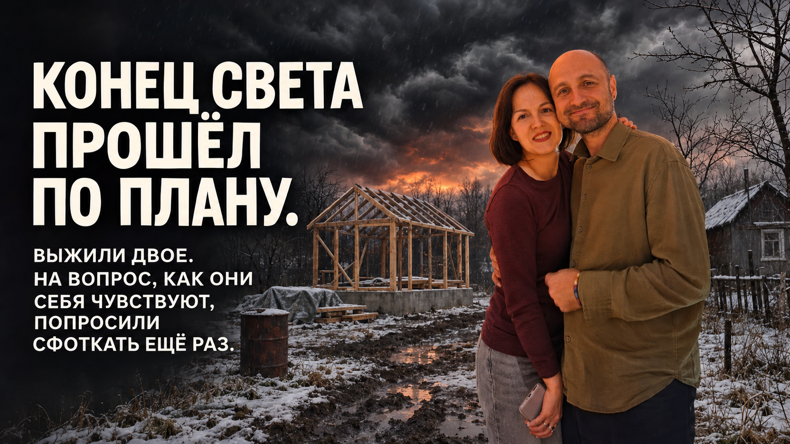
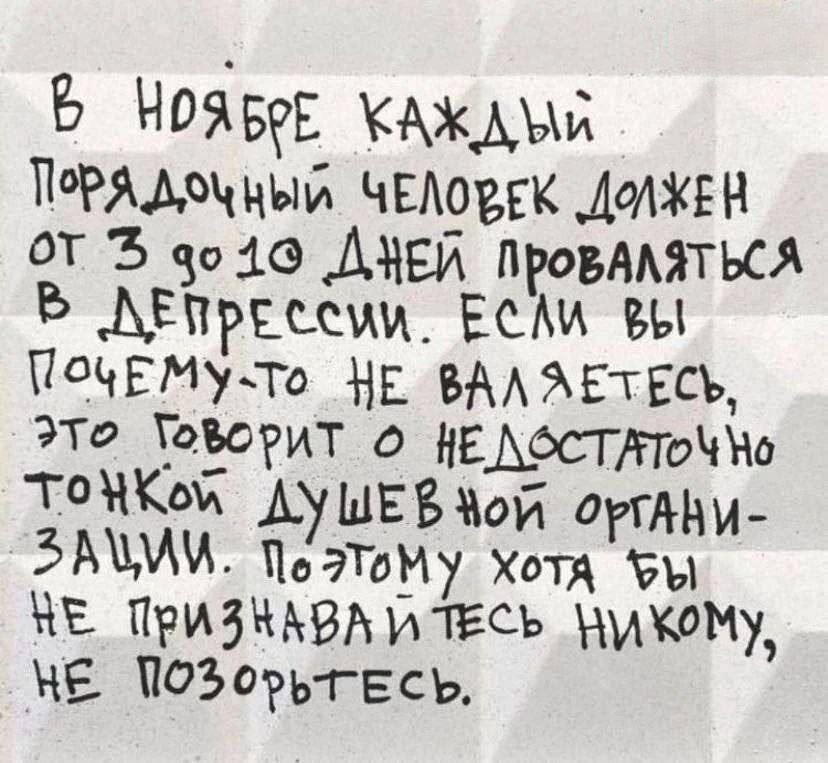

## Ноябрь. Ягодка с пробегом

Пришла зима, и белый снег уже успел надоесть. Ноябрь ещё даже не закончился. Смотрю на это всё и пытаюсь понять, как я подписался ещё на несколько месяцев.

Денег нет, ИИ наступают, как-то надо крутиться. Где бы ещё подзаработать? Желательно без ещё одной работы, а то в сутках уже кончились места. Сам же сижу, разбираюсь с этими ИИ, автоматизирую. Ну правильно, кто ещё им покажет, как меня заменить.

> _МОРТ-7420611359042187: рабочее место ликвидировано. Участие сотрудника в собственных профессиональных похоронах признано успешным внедрением. Лопата доступна по подписке._

Дача ещё эта, баня, стройка, все дела. Сделать хочется много чего, а делать хочется нихера. Фундамент уже есть, обшивки пока нет. В голове я её уже достроил, а помыться почему-то всё равно негде.

Депрессия, что ли? Хотя какая, блять, депрессия у миллениала. Это у зумеров есть название происходящего. У нас в комплекте было «соберись, тряпка». Ну вот, собрался. Теперь лежу собранный. Очень помогло, спасибо.

А тут ноябрь, хлоп - 45. Баба ягодка опять. Я, видимо, та, которую забыли на даче и обнаружили после заморозков. По документам ещё урожай, а на вид уже вопросики прям.

> _МОРТ-7420611359042187: по результатам осмотра ягодка пригодна для дальнейшего погашения обязательств. Списание по причине усталости не предусмотрено. Расходы на утилизацию удержать из остатка._

На картинке вон пишут, что в ноябре положено от трёх до десяти дней проваляться в депрессии. Мне бы ещё понять, где оформляют эти дни. А то всё время кажется, что лежишь не по графику и за это потом придётся отработать.

Короче, накатило что-то. Надо иногда этот поток сознания сюда выплёскивать. Хе-хе.

