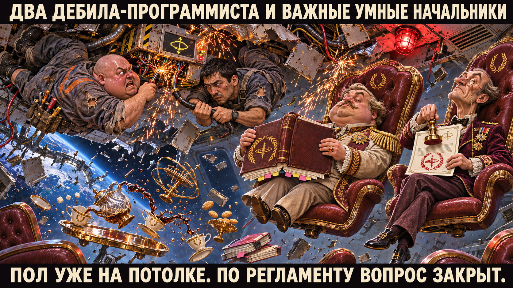

Дело было в далёкой-далёкой галактике, в параллельной вселенной, как-то раз в полседьмого вечера пятницы:

На орбитальной станции решили доработать искусственную гравитацию. В штатном режиме пол был внизу. В нештатном пол тоже желательно было оставить внизу, но тут уже начиналась зона ответственности нескольких подразделений.

Мы с напарником на станции чинили всё, что включалось в розетку, и часть того, что лучше было вообще не включать. Поэтому нас и позвали решать, кому можно менять направление гравитации после стыковки.

Я спросил, что делать, если диспетчер уже подтвердил, где низ, а капитан шаттла хочет его поменять. Отклонить запрос? Попросить диспетчера подтвердить ещё раз? Или разрешить капитану, но только у себя на борту?

Варианты технически нормальные. Первый я мог написать до ужина. Во втором надо было найти диспетчера. В третьем главное, чтобы пассажир не стоял одной ногой в шлюзе, пока у двух ведомств разные представления о низе.

С той стороны спросили, почему мы до сих пор ничего не сделали. Неужели каждый раз надо объяснять нам весь процесс? Мы же здесь работаем. Могли бы уже сами разобраться, кто за что отвечает.

Я открыл регламент. Там было написано: «При возникновении нештатной ситуации направление гравитации определяется ответственным лицом с учётом обстоятельств».

Полистал дальше. Ответственным лицом считалось лицо, на которое возложена ответственность. Обстоятельства предлагалось учитывать в установленном порядке. Порядок предполагал применение регламента.

Короче, круг замкнулся. Это было единственное, что на станции в тот вечер работало без участия разработчиков.

> _МОРТ-7420611359042187: в случае гибели пассажира из-за разночтений в регламенте его кладут горизонтально. Это позволяет закрыть разногласия о том, где у него был низ._

Мы с напарником расписали все три варианта: кто нажимает кнопку, кто подтверждает и что будет с людьми в шлюзе. Попросили выбрать один. Нам сказали, что вот когда мы придём с готовым решением, это будет помощь. А перекладывать на руководство выбор между нашими вариантами каждый способен.

Я говорю: «Могу выбрать. Только вы же потом по этому правилу людей возить будете. Вы точно хотите, чтобы я его утвердил?»

Тут мне объяснили, что утверждать ничего не надо. Правило уже есть в регламенте.

В 18:57 напарник молча добавил в задачу четвёртый вариант: «Оставить пол внизу».

В 18:58 ему прилетел комментарий: «А кто согласовал?»

---

А если без смеха, вот какой разговор у меня случился сегодня. Имена поменял, рабочую задачу заменил на расписание кладбищенских ворот. В чате нас четверо: двое обсуждают, кому решать, и двое ждут, что им в итоге писать.

**Громов:** А, понятно, ладно. Я пошёл писать ТЗ, да? Точнее, не ТЗ, а…

**Шелест:** Нет, ну надо хотя бы понять, что нужно сделать. Вот время закрытия ворот, это первый вопрос. Второй: а зачем смотритель вообще туда полез? И третий момент, мы же это уже обсуждали…

**Громов:** В смысле зачем он туда полез? Затем, что…

**Шелест:** Нет, ну а сейчас-то на что это повлияет? Ты говоришь, он должен был указать время, когда сдавал расписание. Если он тогда промахнулся, это уже его косяк получается. А ты даёшь ему право исправить косяк после утверждения, усложняя систему и процесс.

**Громов:** А что, может, вообще уберём время закрытия тогда, да? Такая логика?

**Шелест:** Я и пытаюсь понять его смысл…

**Громов:** Типа зачем оно нужно. Ладно.

**Шелест:** Вот именно на этапе, когда мы уже общаемся со смотрителем, непонятно, зачем давать ему его менять.

**Громов:** Короче, я не буду сейчас дальше ничего обсуждать. Я понял, что вы ничего не сделали, потому что вы не знаете как. Потому что мне нужно вам всё до сантиметра разжевать, потратить ещё своё время и так далее. Никто не собирается у нас в бизнес-процессы вникать с этой стороны.

**Шелест:** Я вник! Подожди, я в прошлый раз как раз пытался вам донести, что с этим временем закрытия надо…

**Громов:** Донести что?

**Шелест:** Что непонятно с ним вообще ничего после утверждения расписания!

**Громов:** Да, но ты лишь доносишь то, что непонятно, и говоришь «сделайте». Это не помощь, понимаешь? Помощь - это когда человек садится, пишет и говорит: «Ребята, вот так или вот так. Вот есть такие варианты. Вот идём этим путём или этим». Вот тогда это помощь.

**Шелест:** Так я там и сказал! Можно запретить менять время. Можно вернуть расписание на согласование. Можно разрешить смотрителю менять самому. В любой задаче есть несколько составляющих. Первая - придумать бизнес-логику. Я свои варианты накидал, но по своей роли я не могу принять решение, какая логика должна быть заложена. А написать - это уже второй момент.

**Громов:** Бизнес-логика уже заложена, и она описана в регламенте.

В пересчёте на кладбище это звучит так: «При наличии оснований время закрытия ворот может быть изменено по согласованию с ответственным лицом в установленном порядке». В коде как раз нужно указать, какие основания, кто это лицо и закрывать ли ворота, пока оно согласовывает. На все три вопроса нам выдали одну и ту же строчку.

А это уже реальность в нашей, блять, вселенной. Выводы делайте сами.
